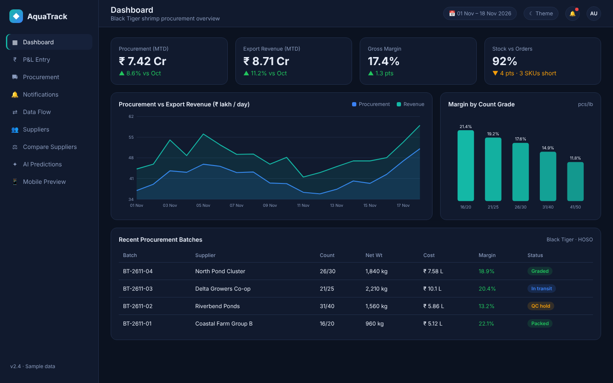
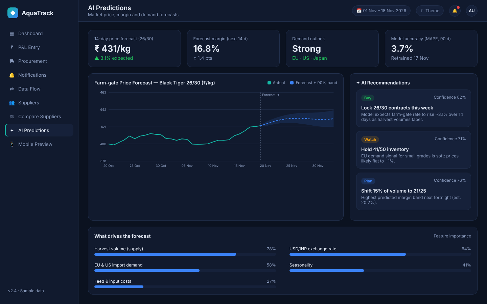

# 🦐 AquaTrack

**Black Tiger shrimp procurement, P&L tracking and AI forecasting in one lightweight web app.**

AquaTrack follows every procurement batch from farm gate to export. It works out profit and loss as each batch is entered, raises alerts when stock, prices or quality need attention, compares suppliers, and gives AI-driven price and margin forecasts.

> ℹ️ This is a showcase repository. The source code is private; this page describes the features, my role and the tech used. All screenshots use sample data.

---

## 📸 Screenshots

### Dashboard
Month-to-date procurement, export revenue, gross margin and stock-vs-order coverage, with daily trends and margin by count grade.

### AI Predictions
14-day farm-gate price forecast with a 90% confidence band, margin and demand outlook, buy/hold/plan recommendations and the factors driving the forecast.

---

## ✨ Features

| Module | What it does |
|---|---|
| **Dashboard** | Procurement, export revenue, gross margin and stock-vs-order KPIs, plus daily trends and margin by count grade |
| **P&L Entry** | Record a batch (supplier, count grade, weights, yield, rates, logistics, FX) and see landed cost, realisation, profit and margin update as you type |
| **Procurement Details** | Searchable, filterable batch list with status tracking (graded, in transit, QC hold, packed, shipped) and CSV export |
| **Notifications** | Alerts for stock shortfalls, farm-gate price spikes, QC holds and shipments, with configurable alert rules |
| **Data Flow** | Diagram of how data moves from farm intake through grading, processing and export |
| **Supplier Directory** | Supplier cards with rating, quality score, average rate and on-time delivery |
| **Compare Suppliers** | Side-by-side metrics, radar performance profile and weekly margin trend |
| **AI Predictions** | 14-day price forecast with confidence band, margin and demand outlook, recommendations and feature importance |
| **Theming** | Dark and light themes |

## 🛠️ Tech Stack

- Vanilla JavaScript (ES6+), HTML5 and CSS3, with no framework and no build step
- Chart.js for line, bar, radar and area charts
- CSS custom properties for dark and light themes
- Template-string rendering with event delegation
- Time-series forecasting using price history, supply, FX, demand and seasonality inputs

## 🗺️ Roadmap

- Backend API and database for multi-user use
- Role-based access for procurement, QC, finance and management
- Push notifications and installable PWA
- Live market price feeds for forecasting
- Pond-level culture tracking (stocking, feed, water quality)
- PDF and Excel export for P&L reports

## 👤 My role

Designed and developed the application end to end: P&L model, procurement workflow, alerting, supplier analytics, forecasting module and the user interface.

---

📫 Want to know more? See my [portfolio](https://varunvasudevan.github.io).
